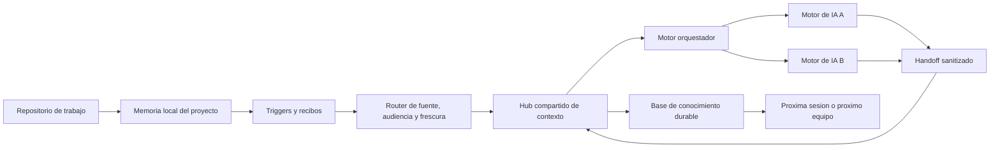

# Persistent AI Memory Workflow

> Can I Play with Madness? Si una IA puede perder el contexto, el workflow
> necesita memoria, limites y evidencia.

Este repositorio documenta un patron para que varios motores de inteligencia
artificial trabajen sobre el mismo conocimiento sin depender de que una sola
ventana recuerde todo. La propuesta separa el codigo, la memoria local del
proyecto, el hub compartido, el conocimiento durable y la publicacion.

El titulo es una referencia editorial a **Can I Play with Madness**, de Iron Maiden,
y a la charla de Chema Alonso que usa esa referencia para hablar de los limites
entre tecnologia, criterio y riesgo. No se reproducen letras ni contenido de
la charla: se toma la pregunta como una buena forma de presentar el problema.

## En 30 segundos

| Problema | Decision | Resultado que busca el patron |
|---|---|---|
| Cada sesion de IA empieza con contexto incompleto | Memoria local por proyecto y un indice compartido | Menos tiempo reconstruyendo el pasado |
| Un motor termina una tarea y otro debe continuarla | Handoffs estructurados y sanitizados | Continuidad entre motores |
| La documentacion queda desactualizada cuando cambia el codigo | Triggers de deteccion, recibos y revision | Cambios visibles sin copiar datos a ciegas |
| Una respuesta privada puede filtrarse a una superficie publica | Clasificacion, audiencia y router | Minimo privilegio documental |
| La automatizacion puede inventar que hizo algo | Evidencia verificable y estados explicitos | Diferenciar plan, hecho y pendiente |

## El problema que resuelve

Los motores de IA no comparten memoria de forma confiable entre sesiones,
proveedores o superficies de trabajo. El resultado suele ser conocido:

- una IA repite preguntas que otra ya resolvio;
- una decision queda en un chat que nadie puede recuperar;
- el codigo avanza, pero la documentacion no refleja el motivo;
- un handoff mezcla datos privados con informacion que si puede circular;
- una automatizacion dice que sincronizo, aunque solo haya detectado un cambio.

Este proyecto propone tratar la memoria como un sistema de informacion:
con fuentes de verdad, contratos, ruteo, frescura, permisos, trazabilidad y
rollback. No intenta convertir a la IA en una autoridad autonoma. La IA ayuda
a leer, clasificar, resumir y ejecutar tareas dentro de limites definidos.

## Arquitectura conceptual

La arquitectura distingue cinco responsabilidades:

1. **Fuente de trabajo:** codigo, documentos o configuracion del proyecto.
2. **Memoria local:** decisiones y continuidad especificas de esa fuente.
3. **Hub:** punteros, solicitudes, respuestas verificables y handoffs.
4. **Orquestacion:** asignacion de tareas entre motores con el minimo contexto.
5. **Conocimiento durable:** principios y decisiones que sobreviven al proyecto.

## Como funciona el workflow

1. Una persona o una IA modifica una fuente de trabajo.
2. Un trigger detecta el evento, mide la divergencia o solicita un recibo.
3. El router identifica la fuente, la clasificacion y la audiencia autorizada.
4. Si falta contexto, se crea una solicitud acotada; no se copia un repositorio.
5. El motor orquestador consulta la fuente correcta o deriva una tarea.
6. Otro motor puede revisar, investigar o implementar una parte delimitada.
7. El resultado vuelve como handoff o respuesta sanitizada, con evidencia.
8. La proxima IA lee el puntero y continua desde un estado comprensible.
9. Solo las decisiones realmente durables pasan a la base de conocimiento.

### Una aclaracion importante sobre los archivos

Editar un archivo no deberia reescribir automaticamente todo el registro compartido. El
patron correcto es mas preciso:

- el cambio puede quedar visible como **divergencia** en el proximo arranque;
- un cierre de sesion puede registrar un **recibo** y una entrada de memoria;
- un commit puede ejecutar una **validacion** o emitir un aviso de revision;
- un plan explicito puede proponer una actualizacion;
- la escritura durable requiere una accion autorizada y una clasificacion.

Asi, la automatizacion mueve informacion de forma controlada, pero no inventa
una sincronizacion universal ni convierte un cambio local en una publicacion.

## Triangulacion entre motores

Un escenario ilustrativo puede usar Claude, Codex y Gemini con estos roles:

- **Claude:** trabaja dentro del proyecto, detecta que falta contexto y formula
  la pregunta minima.
- **Codex:** actua como orquestador, consulta el hub y deriva una tarea con
  alcance, audiencia y restricciones.
- **Gemini:** revisa una parte delimitada, aporta una alternativa o ejecuta una
  investigacion independiente.
- **Hub:** conserva el handoff sanitizado para que Claude pueda continuar.

Los nombres representan roles intercambiables. La integracion concreta depende
de los conectores disponibles; este repositorio documenta el contrato del flujo,
no afirma que todas las conexiones esten activas en todos los entornos.

## Documentacion

- [Arquitectura y modelo mental](docs/01-arquitectura.md)
- [Triggers, recibos y automatizacion](docs/02-triggers-y-automatizacion.md)
- [Memoria, ruteo y triangulacion](docs/03-memoria-ruteo-y-triangulacion.md)
- [Escala profesional y empresarial](docs/04-escala-profesional.md)
- [Seguridad, privacidad y sanitizacion](docs/05-seguridad-y-sanitizacion.md)
- [Caso de estudio: de contexto perdido a memoria operable](docs/casos-de-estudio/01-contexto-perdido-y-memoria-operable.md)
- [Playbook de implementacion](docs/06-playbook-de-implementacion.md)

## Que puede resolver en una empresa

El patron puede sostener una red de conocimiento donde cada area conserva su
fuente de verdad, mientras una capa comun permite que las IA encuentren lo que
necesitan sin mezclar permisos. Por ejemplo:

- documentacion de producto alimentando soporte y desarrollo;
- decisiones de seguridad disponibles para infraestructura y auditoria;
- handoffs entre turnos, proveedores y equipos distribuidos;
- actualizacion guiada de runbooks despues de un cambio aprobado;
- indice comun de politicas, contratos, procesos y excepciones;
- asistentes que responden con frescura y declaran cuando no tienen evidencia.

La escala cambia la infraestructura, no el principio: cada dominio debe seguir
teniendo una autoridad, una audiencia y un limite de exposicion claros.

## Lo que este repositorio no promete

- No elimina la necesidad de revision humana en decisiones sensibles.
- No convierte cualquier carpeta en una fuente confiable.
- No sincroniza datos privados hacia una base publica.
- No reemplaza control de versiones, backups, permisos ni auditoria.
- No considera que una respuesta de IA sea evidencia por si sola.

## Publicacion y sanitizacion

Este repositorio es documental y esta preparado para ser publico. No contiene
rutas reales de una workstation, nombres de hosts, direcciones, credenciales,
tokens, logs, dumps, capturas operativas ni cuerpos privados. Los ejemplos son
abstractos y los nombres de motores se usan como roles tecnicos.

La publicacion del repositorio y la creacion del remoto son decisiones separadas
de la escritura local. La carpeta puede prepararse, validarse y versionarse sin
hacer push.

## Licencia

Ver [LICENSE.md](LICENSE.md).
