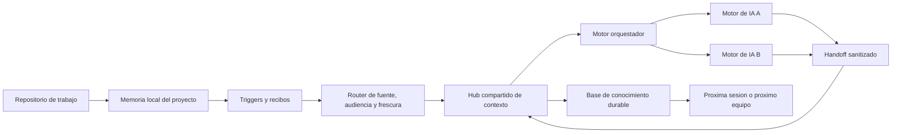

# Can I Play with Madness?

> Si. La IA puede improvisar. Las decisiones importantes merecen una partitura.

  <strong>VARIOS MOTORES · UNA MEMORIA COMPARTIDA · CRITERIO QUE PERDURA</strong>

  <a href="#en-30-segundos">El problema</a> ·
  <a href="#arquitectura-conceptual">El diseño</a> ·
  <a href="#recorrido-de-lectura">La partitura</a> ·
  <a href="#que-puede-resolver-en-una-empresa">La escala</a>

ChatGPT, Codex, Claude, Claude Code, modelos locales y un fallback pueden
participar del mismo trabajo. Cada uno aporta algo; ninguno recuerda por arte
de magia lo que hicieron los demas. Sin un protocolo, la siguiente sesion pide
otra vez una decision que ya explicamos tres veces. La cuarta explicacion
empieza a parecer parte del puesto de trabajo.

Este proyecto muestra criterio profesional para usar varios motores: conservar
decisiones, recuperar contexto, verificar resultados y administrar capacidad.
Podemos jugar con la locura si implementamos la IA con memoria, limites y una
forma concreta de relevar el trabajo.

Este repositorio documenta un patron para que varios motores de inteligencia
artificial trabajen sobre el mismo conocimiento sin depender de que una sola
ventana recuerde todo. La propuesta separa el codigo, la memoria local del
proyecto, el hub compartido, el conocimiento durable y la publicacion.

## En 30 segundos

| Problema | Decision | Resultado que busca el patron |
|---|---|---|
| Cada sesion de IA empieza con contexto incompleto | Memoria local por proyecto y un indice compartido | Menos tiempo reconstruyendo el pasado |
| Un motor termina una tarea y otro debe continuarla | Handoffs estructurados y sanitizados | Continuidad entre motores |
| La documentacion queda desactualizada cuando cambia el codigo | Triggers de deteccion, recibos y revision | Cambios visibles sin copiar datos a ciegas |
| Una respuesta privada puede filtrarse a una superficie publica | Clasificacion, audiencia y router | Minimo privilegio documental |
| La automatizacion puede inventar que hizo algo | Evidencia verificable y estados explicitos | Diferenciar plan, hecho y pendiente |

## El problema que resuelve

Los motores de IA no comparten memoria de forma confiable entre sesiones,
proveedores o superficies de trabajo. El resultado suele ser conocido:

- una IA repite preguntas que otra ya resolvio;
- una decision queda en un chat que nadie puede recuperar;
- el codigo avanza, pero la documentacion no refleja el motivo;
- un handoff mezcla datos privados con informacion que si puede circular;
- una automatizacion dice que sincronizo, aunque solo haya detectado un cambio.

Este proyecto propone tratar la memoria como un sistema de informacion:
con fuentes de verdad, contratos, ruteo, frescura, permisos, trazabilidad y
rollback. No intenta convertir a la IA en una autoridad autonoma. La IA ayuda
a leer, clasificar, resumir y ejecutar tareas dentro de limites definidos.

## Arquitectura conceptual

La arquitectura distingue cinco responsabilidades:

1. **Fuente de trabajo:** codigo, documentos o configuracion del proyecto.
2. **Memoria local:** decisiones y continuidad especificas de esa fuente.
3. **Hub:** punteros, solicitudes, respuestas verificables y handoffs.
4. **Orquestacion:** asignacion de tareas entre motores con el minimo contexto.
5. **Conocimiento durable:** principios y decisiones que sobreviven al proyecto.

**Segui el mapa:** [Arquitectura y modelo mental](docs/01-arquitectura.md)
explica por que cada responsabilidad tiene su propio lugar.

## Como funciona el workflow

### Una memoria general y una memoria por proyecto

La memoria general conserva reglas transversales y decisiones que afectan a
varios proyectos. El hub compartido es el lugar que aloja esa memoria, el
catalogo y los relevos. Cada repositorio mantiene ademas su memoria propia:
estado actual, decisiones, errores, evidencia y proximo paso. El detalle se
escribe una sola vez en el proyecto; el hub guarda coordinacion y punteros.

Ejemplo ficticio: una aplicacion conserva una validacion para impedir un envio
duplicado. El codigo contiene la validacion; la memoria explica por que existe,
como se probo y que falta. El siguiente motor consulta esa memoria antes de
proponer cambios. El hub permite encontrarla sin copiar toda la aplicacion.

Memoria persistente significa recuperar contexto externo cuando hace falta.
No cambia los pesos del modelo: el conocimiento sobrevive al chat porque esta
en documentos propios. La memoria de la plataforma queda como apoyo secundario.

**Dentro del proyecto:** [La partitura de cada proyecto](docs/07-memoria-de-proyecto.md)
recorre sus documentos y muestra una sesion completa, desde el arranque hasta
el relevo al siguiente motor.

### El router, la audiencia y la frescura

El router localiza la fuente correcta y comprueba si puede entregar informacion.
La audiencia es quien esta autorizado a recibirla: un equipo de desarrollo y
un lector publico tienen permisos distintos. La frescura indica si la respuesta
sigue representando a la fuente. Una cache escrita ayer puede estar vencida si
el archivo cambio hoy, incluso antes de hacer commit.

Si hay una respuesta autorizada y vigente, se reutiliza. Si falta, se consulta
la fuente. Si no hay permiso, se devuelve un puntero o se detiene la consulta.
"Mandale todo, por las dudas" deja de ser la estrategia de contexto. Suele
funcionar hasta que alguien pregunta que habia en "todo".

**Quien recibe que:** [Memoria, ruteo y triangulacion](docs/03-memoria-ruteo-y-triangulacion.md)
desarrolla audiencia, clasificacion, frescura y autoridad con un glosario.

### El circuito completo

1. Una persona o una IA modifica una fuente de trabajo.
2. Un trigger detecta el evento, mide la divergencia o solicita un recibo.
3. El router identifica la fuente, la clasificacion y la audiencia autorizada.
4. Si falta contexto, se crea una solicitud acotada; no se copia un repositorio.
5. El motor orquestador consulta la fuente correcta o deriva una tarea.
6. Otro motor puede revisar, investigar o implementar una parte delimitada.
7. El resultado vuelve como handoff o respuesta sanitizada, con evidencia.
8. La proxima IA lee el puntero y continua desde un estado comprensible.
9. Solo las decisiones realmente durables pasan a la base de conocimiento.

### Una aclaracion importante sobre los archivos

Editar un archivo no deberia reescribir automaticamente todo el registro compartido. El
patron correcto es mas preciso:

- el cambio puede quedar visible como **divergencia** en el proximo arranque;
- un cierre de sesion puede registrar un **recibo** y una entrada de memoria;
- un commit puede ejecutar una **validacion** o emitir un aviso de revision;
- un plan explicito puede proponer una actualizacion;
- la escritura durable requiere una accion autorizada y una clasificacion.

Asi, la automatizacion mueve informacion de forma controlada, pero no inventa
una sincronizacion universal ni convierte un cambio local en una publicacion.

**Cuando entra cada control:** [Triggers, recibos y automatizacion](docs/02-triggers-y-automatizacion.md)
conecta eventos, scripts y verificaciones con su proposito.

## Triangulacion entre motores

Un escenario ilustrativo puede usar Claude, Codex y Gemini con estos roles:

- **Claude:** trabaja dentro del proyecto, detecta que falta contexto y formula
  la pregunta minima.
- **Codex:** actua como orquestador, consulta el hub y deriva una tarea con
  alcance, audiencia y restricciones.
- **Gemini:** revisa una parte delimitada, aporta una alternativa o ejecuta una
  investigacion independiente.
- **Hub:** conserva el handoff sanitizado para que Claude pueda continuar.

Los nombres representan roles intercambiables. La integracion concreta depende
de los conectores disponibles; este repositorio documenta el contrato del flujo,
no afirma que todas las conexiones esten activas en todos los entornos.

## Recorrido de lectura

Cada capitulo responde una pregunta. Podes seguir el recorrido o entrar por
el tema que necesitas entender.

| Paso | La pregunta | Abri la partitura |
|---|---|---|
| 01 | Que problema llevo a construir esto? | [El caso: contexto perdido](docs/casos-de-estudio/01-contexto-perdido-y-memoria-operable.md) |
| 02 | Como encajan memoria, fuentes y hub? | [Arquitectura y modelo mental](docs/01-arquitectura.md) |
| 03 | Que recuerda cada proyecto y como lo recupera otra IA? | [Memoria de proyecto, paso a paso](docs/07-memoria-de-proyecto.md) |
| 04 | Que se dispara al iniciar, cerrar o commitear? | [Triggers, recibos y automatizacion](docs/02-triggers-y-automatizacion.md) |
| 05 | Como viaja el contexto y quien puede recibirlo? | [Router, audiencia, frescura y triangulacion](docs/03-memoria-ruteo-y-triangulacion.md) |
| 06 | Como se reparten motores, fallback y tokens? | [Motores y presupuesto](docs/08-motores-fallback-y-tokens.md) |
| 07 | Como se protege lo que no debe circular? | [Seguridad y sanitizacion](docs/05-seguridad-y-sanitizacion.md) |
| 08 | Que cambia cuando participa toda una empresa? | [Escala profesional](docs/04-escala-profesional.md) |
| 09 | Como empezar a implementarlo? | [Playbook de implementacion](docs/06-playbook-de-implementacion.md) |

## Que puede resolver en una empresa

El patron puede sostener una red de conocimiento donde cada area conserva su
fuente de verdad, mientras una capa comun permite que las IA encuentren lo que
necesitan sin mezclar permisos. Por ejemplo:

- documentacion de producto alimentando soporte y desarrollo;
- decisiones de seguridad disponibles para infraestructura y auditoria;
- handoffs entre turnos, proveedores y equipos distribuidos;
- actualizacion guiada de runbooks despues de un cambio aprobado;
- indice comun de politicas, contratos, procesos y excepciones;
- asistentes que responden con frescura y declaran cuando no tienen evidencia.

La escala cambia la infraestructura, no el principio: cada dominio debe seguir
teniendo una autoridad, una audiencia y un limite de exposicion claros.

**Llevalo a un equipo:** [Escala profesional y empresarial](docs/04-escala-profesional.md)
describe dominios, responsables y un despliegue por etapas.

## Lo que este repositorio no promete

- No elimina la necesidad de revision humana en decisiones sensibles.
- No convierte cualquier carpeta en una fuente confiable.
- No sincroniza datos privados hacia una base publica.
- No reemplaza control de versiones, backups, permisos ni auditoria.
- No considera que una respuesta de IA sea evidencia por si sola.

## Los motores del workflow

| Herramienta | Papel en este ecosistema |
|---|---|
| ChatGPT y Codex | Conversacion y trabajo sobre repositorios; Codex verifica archivos y puede coordinar tareas delimitadas |
| Claude y Claude Code | Analisis y trabajo tecnico; Claude Code dispone de controles de ciclo de sesion |
| IA local: Qwen3 Instruct y Qwen3 VL Instruct | Familias de texto y multimodal disponibles localmente; su aptitud se comprueba por tarea |
| Antigravity | Fallback de continuidad con contexto minimo y uso consciente del presupuesto disponible |

Se describen herramientas utilizadas y familias locales verificadas como
instaladas. No se atribuye una integracion automatica a partir de la instalacion.
El ahorro usa respuestas vigentes, consultas acotadas y relevos pequenos; no
hay porcentajes medidos ni conmutacion automatica por consumo acreditados aqui.

**Reparti el trabajo:** [Motores, fallback y tokens](docs/08-motores-fallback-y-tokens.md)
explica como continuar con contexto minimo y administrar capacidad.

## Entonces, podemos jugar con la locura?

Si. Con memoria local, una autoridad por tema y relevos verificables, podemos
cambiar de motor sin empezar de cero. En una empresa, el mismo criterio permite
que cada area mantenga sus fuentes y los agentes encuentren contexto vigente
con permisos definidos. Tener cuatro guitarristas no obliga a que todos hagan
el solo: el valor esta en repartir el trabajo y conservar la partitura.

## Publicacion y sanitizacion

Este repositorio es documental y esta preparado para ser publico. No contiene
rutas reales de una workstation, nombres de hosts, direcciones, credenciales,
tokens, logs, dumps, capturas operativas ni cuerpos privados. Los ejemplos son
abstractos y los nombres de motores se usan como roles tecnicos.

La publicacion del repositorio y la creacion del remoto son decisiones separadas
de la escritura local. La carpeta puede prepararse, validarse y versionarse sin
hacer push.

## Licencia

Ver [LICENSE.md](LICENSE.md).
