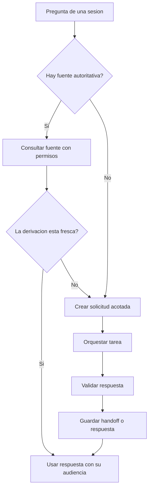
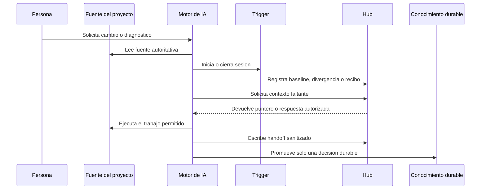

# Arquitectura y modelo mental

**Idioma / Language:** Espanol | [English](en/01-architecture.md)

Can I Play with Madness? La arquitectura es la partitura: define que recuerda
cada proyecto y como encuentran contexto los distintos motores.

El hub es un nodo compartido de coordinacion y memoria general. Un catalogo
localiza fuentes; un indice localiza temas. La memoria de proyecto explica
decisiones propias. Esta separacion permite continuidad sin convertir cada
motor en el propietario de una version diferente del conocimiento.

La arquitectura no empieza por el modelo de IA. Empieza por la autoridad de
los datos y por la pregunta: que debe sobrevivir cuando se cierra la sesion.

## 1. Capas

| Capa | Responsabilidad | No debe hacer |
|---|---|---|
| Fuente de trabajo | Contener codigo, documentos o configuracion de un dominio | Ceder su autoridad a un resumen viejo |
| Memoria local | Guardar decisiones y continuidad del proyecto | Copiar toda la fuente al hub |
| Hub compartido | Rutar solicitudes, respuestas y handoffs | Ser un deposito de secretos |
| Orquestador | Elegir motor, alcance y proximo paso | Ocultar quien hizo que |
| Conocimiento durable | Conservar principios y decisiones reutilizables | Reemplazar la evidencia operativa |
| Superficie publica | Mostrar criterio y patrones | Identificar o reproducir el entorno real |

## 2. La regla de autoridad

Hay una fuente autoritativa por tema. La memoria es un puntero o una derivacion
con fecha, clasificacion y evidencia; nunca gana a la fuente cuando contradice
los hechos.

## 3. Objetos del flujo

El sistema puede usar nombres cortos para que los agentes sepan que estan
leyendo. Son contratos, no formatos obligatorios:

- **RQ:** solicitud de informacion a una fuente autorizada.
- **CA:** respuesta derivada, sanitizada y verificable.
- **HO:** handoff de continuidad, con estado y proximo paso.
- **MEM:** decision o aprendizaje durable en su destino autoritativo.
- **Receipt:** recibo de una sesion, con identidad, evidencia y resultado.

Cada objeto debe responder como minimo:

1. Que se pidio o cambio.
2. Quien o que motor lo produjo.
3. Sobre que fuente se baso.
4. Para quien puede leerse.
5. Que evidencia respalda la afirmacion.
6. Que queda pendiente.

## 4. Por que no es una sincronizacion bidireccional

Una sincronizacion ingenua genera dos problemas: copias vencidas y autoridad
ambigua. El patron usa flujo de consultas y respuestas:

- la fuente sigue en su repositorio;
- el hub guarda el minimo puntero necesario;
- el agente consulta cuando le falta contexto;
- la respuesta se reemplaza cuando pierde frescura;
- una decision durable se promueve de forma explicita.

Esto permite que el sistema sea portable entre motores sin hacer del hub una
segunda copia de cada proyecto.

## 5. Flujo de sesion

## 6. Decisiones de diseno

### Persistir menos, pero mejor

Guardar el cuerpo completo de cada conversacion aumenta ruido y riesgo. Se
conserva la decision, el contexto minimo, la evidencia y el proximo paso.

### Separar detectar de escribir

Un trigger puede detectar un cambio sin tener permiso para reescribir la
memoria. La propuesta se revisa y la escritura se hace con una operacion
delimitada.

### Separar orquestar de ejecutar

El motor que deriva una tarea no tiene que recibir todas las credenciales ni
todos los documentos. Puede entregar un contrato minimo a otro motor.

### Hacer visible la incertidumbre

"S/D", "requiere autorizacion" y "pendiente de verificar" son estados sanos.
Un sistema de memoria que completa silenciosamente los huecos produce confianza
falsa.

## 7. Limites

La arquitectura no resuelve por si sola identidad, control de acceso,
retencion legal, calidad de documentos ni alucinaciones. Solo ofrece un lugar
claro para aplicar esos controles y dejar evidencia de su resultado.
