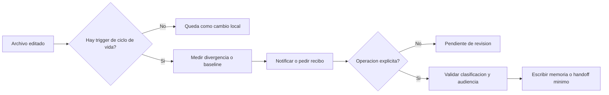

# Triggers, recibos y automatizacion

**Idioma / Language:** Espanol | [English](en/02-triggers-and-automation.md)

Can I Play with Madness? Los triggers son las entradas a tiempo: el control
correcto cuando empieza una sesion, termina una tanda o se prepara un commit.

Un hook conecta ese evento con un script. Un wrapper local adapta el evento al
runtime compartido de verificacion. Un recibo guarda identidad y evidencia del
cierre. La entrada de memoria explica el significado del trabajo: cada pieza
tiene una funcion diferente.

Por que existen: una regla escrita puede olvidarse al cambiar de sesion. Para
que sirven: detectar que falta continuidad y exigir evidencia antes del cierre.
Los scripts usan Git, metadata, hashes y contratos de proyecto; la redaccion de
hechos sigue a cargo del agente que comprobo el resultado.

Un trigger es una reaccion a un evento. No es una autorizacion general para
leer, copiar o publicar datos.

## 1. Matriz de eventos

| Evento | Accion segura | Lo que no hace automaticamente |
|---|---|---|
| Inicio de sesion | Muestra punteros, baseline y divergencias | No inyecta cuerpos privados ni reemplaza la lectura de reglas |
| Pre-compactacion | Conserva un punto de continuidad | No resume secretos ni decide que es durable |
| Cierre de sesion | Valida identidad, evidencia y proximo paso | No declara exito sin archivos verificados |
| Pre-commit | Comprueba higiene, clasificacion y recibo si corresponde | No genera una memoria narrativa por si solo |
| Post-commit de una fuente | Emite aviso para revisar material derivable | No copia ni publica el commit |
| Plan explicito | Propone operaciones con hashes, locks y alcance | No escribe hasta una aplicacion autorizada |
| Apply explicito | Ejecuta solo el plan aceptado | No altera superficies fuera del plan |
| Verificacion | Compara estado y evidencia | No corrige silenciosamente una contradiccion |

## 2. Que pasa cuando alguien toca un archivo

El evento de edicion y el evento de persistencia son distintos.



Por eso la respuesta precisa a "si toco un archivo, se actualiza el registro"
es: **se puede disparar la deteccion y el relevo, pero el registro compartido solo se
actualiza como memoria durable cuando el contrato de cierre lo autoriza**. Esta
distincion evita bucles y evita que cada guardado de un editor produzca ruido.

## 3. Recibo de sesion

Un recibo debe poder contestar:

```text
project: dominio o identificador abstracto
session_id: identificador de la sesion
engine: motor que trabajo
root: raiz verificada, sin exponer rutas privadas en superficies publicas
memory_entry: MEM- o referencia de continuidad
evidence: archivos y estados comprobados
coordination: pending | completed | requires-authorization
```

El recibo no es la memoria. Es la evidencia de que una sesion produjo o no
produjo un cambio que merece entrar en memoria.

## 4. Pseudocodigo del arranque

```text
on_session_start(project):
    assert_git_root(project)
    baseline = load_previous_receipt(project)
    pointers = read_index(project)
    divergences = compare_scoped_status(project, baseline)
    show(pointers, divergences)
    require_agent_to_read_authoritative_sources()
```

El arranque informa; no sustituye el juicio del motor. Si el hub no esta
disponible, el proyecto puede continuar con su paquete local y dejar la
coordinacion pendiente.

## 5. Pseudocodigo del cierre

```text
on_session_close(project, session):
    facts = verify_files_and_status(project)
    if facts.changed and session.memory_entry is missing:
        stop("falta entrada de memoria local")
    if session.coordination == "completed":
        assert_hub_reference(session)
    write_receipt(session, facts)
```

Los hechos, las inferencias y los pendientes deben quedar separados. El cierre
no transforma una recomendacion en un hecho ejecutado.

## 6. Pre-commit y post-commit

El pre-commit es una barrera de higiene. Puede comprobar whitespace, presencia
de recibos, superficies ignoradas y coherencia minima. No debe crear una copia
del repositorio ni enviar datos a un servicio externo.

El post-commit puede marcar que un cambio de arquitectura o documentacion merece
revision en un portfolio. La accion esperada es un aviso: una persona o un
agente autorizado escribe una version transformada y el propietario decide si
se publica.

## 7. Plan y aplicacion

Las operaciones de mayor alcance deben dividirse:

1. **Check:** medir el estado actual.
2. **Plan:** producir operaciones con antes, despues, hash y alcance.
3. **Review:** confirmar clasificacion y audiencia.
4. **Apply:** ejecutar solo lo aprobado.
5. **Verify:** comprobar que el resultado coincide.
6. **Receipt:** registrar evidencia y rollback.

Este ciclo permite detenerse entre deteccion y escritura. Tambien permite
deshacer una transaccion sin resetear ni borrar trabajo posterior.

## 8. Portabilidad

Los triggers deben depender de una raiz verificada y de un resolver de rutas,
no de una ruta fija escrita dentro de cada script. Una implementacion portable
conserva una forma canonica para cada plataforma y rechaza aliases ambiguos.

La portabilidad es de ubicacion y contrato; no autoriza leer una fuente que la
clasificacion prohibe.
