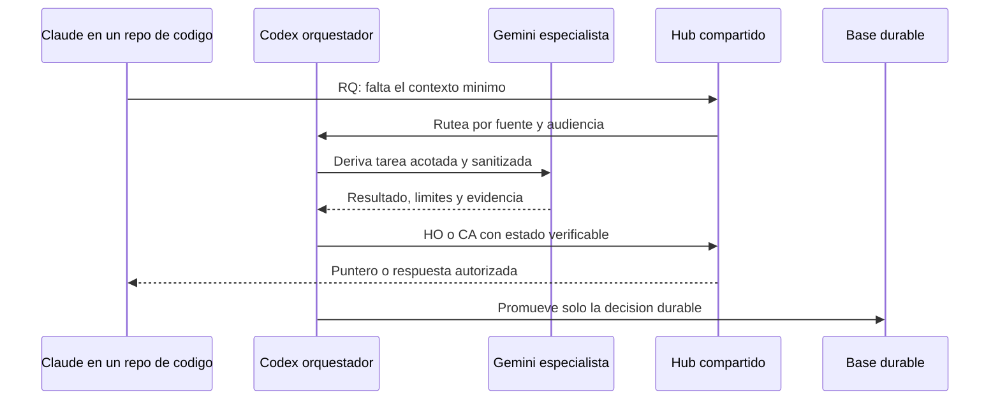

# Memoria, ruteo y triangulacion

Esta es la parte que permite que una IA le pase trabajo a otra sin que la
tercera tenga que volver a descubrir todo desde cero.

## 1. El circuito de una pregunta faltante



El valor no esta en que los tres motores "hablen" directamente. Esta en que
comparten un contrato visible, con autoridad y limites.

## 2. Ejemplo narrativo

Una persona esta trabajando en una aplicacion y pregunta a Claude por que una
decision de arquitectura se tomo de cierta forma. Claude encuentra el codigo,
pero no la razon historica.

1. Claude no inventa la respuesta: crea una solicitud minima.
2. Codex consulta el indice y descubre que la respuesta vive en una fuente
   documental autorizada.
3. Codex deriva a Gemini una revision comparativa, sin enviar cuerpos privados
   que no hagan falta.
4. Gemini entrega una conclusion, los supuestos y lo que no pudo verificar.
5. Codex transforma el resultado en un handoff o respuesta cacheada.
6. Claude recibe el puntero y continua el cambio de codigo.
7. Si la decision es reusable, se promueve a conocimiento durable con audiencia
   definida.

En una implementacion real, Gemini podria ser otro proveedor, un modelo local o
un servicio especializado. El rol es mas importante que la marca.

## 3. Frescura

Una respuesta derivada no es eterna. Para saber si sigue vigente se necesita:

- identificador de la fuente;
- subruta o unidad logica consultada;
- hash o version de la subruta;
- estado de cambios sin confirmar;
- fecha de medicion;
- clasificacion y audiencia.

Si la fuente cambio o tiene trabajo sin confirmar, la respuesta se considera
vencida aunque el identificador global del repositorio no haya cambiado.

## 4. Clasificacion y audiencia

Un router puede trabajar con cuatro resultados simples:

| Clasificacion | Uso en el hub publico |
|---|---|
| Publica | Puede aparecer en un ejemplo sanitizado |
| Interna | Solo circula dentro de la organizacion autorizada |
| Solo local | Se conserva en la fuente y solo se deja un puntero controlado |
| Indexada sin contenido | Se registra que existe y como rutearla, sin resumen |

La audiencia es una segunda barrera. Que un agente tenga acceso a un indice no
significa que pueda leer el cuerpo de la fuente.

## 5. Que debe transportar un handoff

```yaml
id: HO-YYYYMMDD-HHMMSS-topic
status: open
engine: orchestrator-or-specialist
source: logical-source-id
classification: internal
summary: sanitized one-paragraph state
verified:
  - fact checked in the source
next_step: concrete action
blocked_by: none-or-explicit-blocker
audience: project-team
```

El campo `summary` no es una copia de la fuente. Es una explicacion minima para
que el siguiente motor sepa donde continuar. Si el contenido no esta autorizado
para el hub, el handoff solo dice que existe una fuente y que requiere consulta
local.

## 6. La memoria que llega a una base como Obsidian

Una base de conocimiento puede funcionar como destino de conceptos durables:

- principios de arquitectura;
- decisiones con motivo y trade-off;
- definiciones de dominio;
- procedimientos que deben sobrevivir a un cambio de persona;
- referencias a fuentes, sin duplicar sus cuerpos.

El flujo recomendado es fuente -> memoria local -> handoff sanitizado -> base
durable. No es una sincronizacion ciega en sentido contrario. La base durable
debe apuntar a la autoridad y declarar su frescura.

## 7. Antibucles

La triangulacion puede producir un bucle si cada motor vuelve a escribir al
otro. Para evitarlo:

1. cada objeto tiene un productor y un destinatario;
2. cada escritura tiene un evento de origen;
3. el router ignora su propia salida como nueva entrada;
4. un recibo impide cerrar dos veces la misma sesion;
5. una promocion durable requiere cambio semantico, no solo movimiento de texto.

## 8. Integracion honesta

Este repositorio usa Claude, Codex y Gemini como nombres de ejemplo porque
explican bien la triangulacion. No se debe afirmar que existe una integracion
automatica hasta tener un conector, un permiso, una prueba y una evidencia de
salida. Si no hay evidencia, el estado correcto es "diseno" o "pendiente".
