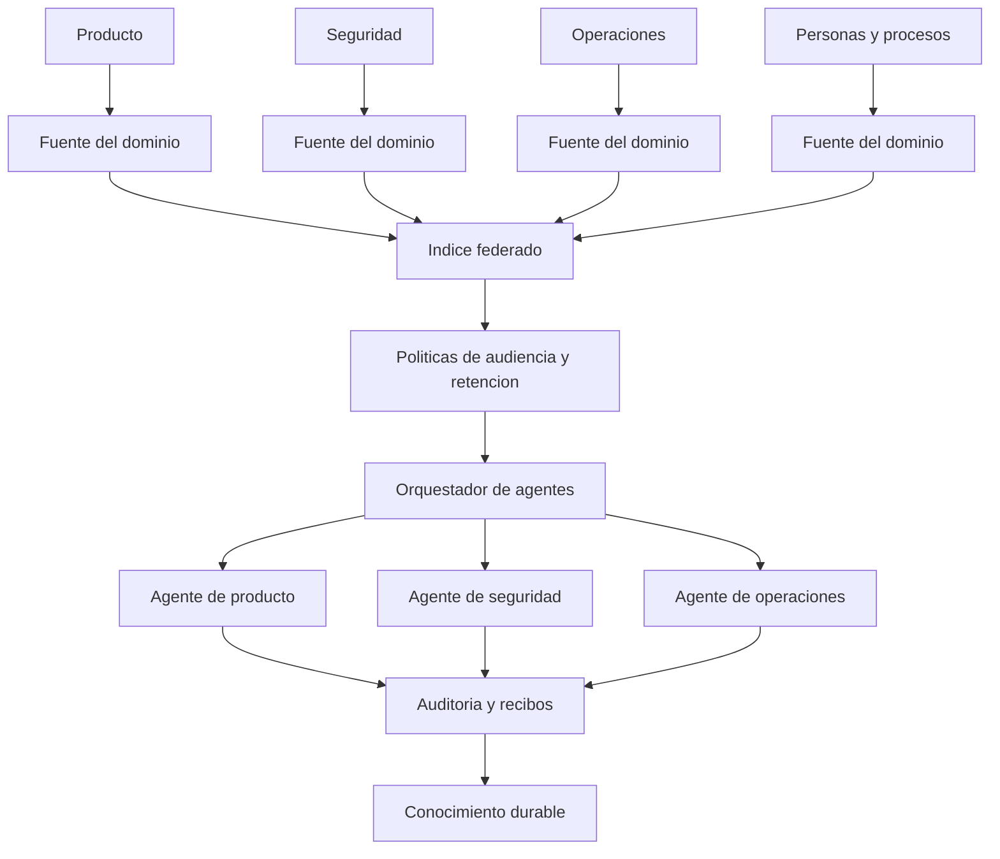

# Escala profesional y empresarial

**Idioma / Language:** Espanol | [English](en/04-professional-scale.md)

Can I Play with Madness? A escala empresarial la pregunta se transforma en
como coordinar muchas voces con propietarios, permisos y fuentes vigentes.
La propuesta requiere responsables por dominio: reunir documentos sin esos
contratos multiplica la ambiguedad que los agentes reciben.

En un equipo pequeno, el hub puede ser un repositorio Markdown. En una empresa,
el mismo patron puede convertirse en una plataforma de conocimiento gobernada.
La idea central no cambia: cada dominio mantiene autoridad y la IA consulta por
contratos.

## 1. Topologia de referencia

## 2. Que problemas de empresa ataca

### Perdida de contexto entre equipos

Los handoffs estructurados reemplazan mensajes dispersos por un estado pequeno,
verificable y dirigido a una audiencia.

### Documentacion que envejece

Los triggers detectan que una fuente cambio y marcan que el documento derivado
necesita revision. No prometen que el texto se actualice sin validar el sentido.

### Conocimiento tribal

Las decisiones durables dejan de depender de una persona o de un chat privado.
La fuente y el motivo siguen visibles para quienes tienen permiso.

### Respuestas inconsistentes

Un indice federado y contratos comunes permiten que distintos agentes consulten
la misma autoridad y declaren la version de la evidencia.

### Riesgo de filtracion

La clasificacion, la audiencia y el minimo contexto limitan cuanto recibe cada
agente. El modelo no debe recibir todo solo porque puede recibir algo.

## 3. Areas que puede alimentar

| Area | Ejemplo de entrada | Salida segura |
|---|---|---|
| Ingenieria | Cambio de codigo o ADR | Runbook y handoff tecnico |
| Soporte | Incidente resuelto | Articulo de diagnostico con version |
| Seguridad | Excepcion aprobada | Control, responsable y vencimiento |
| Operaciones | Cambio de procedimiento | Checklist con rollback |
| Legal y compliance | Politica vigente | Puntero con audiencia, no copia abierta |
| Recursos humanos | Proceso interno | Resumen solo para el grupo autorizado |

La ultima columna no implica que todas las areas puedan compartir informacion.
El router debe conservar la frontera de cada dominio.

## 4. Modelo de implementacion por etapas

### Etapa 1: disciplina documental

- nombrar fuentes autoritativas;
- definir memoria local y handoff;
- acordar clasificaciones y audiencias;
- medir frescura manualmente.

### Etapa 2: triggers locales

- detectar inicio y cierre de sesiones;
- validar cambios en pre-commit;
- emitir avisos post-commit;
- guardar recibos sin cuerpos sensibles.

### Etapa 3: router e indice federado

- resolver una fuente desde un registro;
- bloquear clasificaciones no autorizadas;
- exigir version o hash;
- rutar solicitudes al equipo dueno.

### Etapa 4: orquestacion multiagente

- separar planner, executor y reviewer;
- delimitar herramientas por agente;
- registrar handoffs y errores;
- aplicar limites de tiempo y presupuesto.

### Etapa 5: conocimiento empresarial

- promover decisiones reutilizables;
- definir retencion y borrado;
- medir frescura y cobertura;
- integrar busqueda semantica solo donde la politica lo permita.

## 5. Indicadores utiles

Un sistema de memoria no se mide por la cantidad de texto guardado. Se puede
observar:

- porcentaje de preguntas resueltas desde una fuente vigente;
- edad de las respuestas derivadas por dominio;
- tiempo desde un cambio de codigo hasta el aviso documental;
- handoffs abiertos, cerrados y bloqueados;
- respuestas sin fuente o con audiencia incorrecta;
- cantidad de escrituras rechazadas por clasificacion;
- tiempo para que una persona nueva recupere el contexto minimo.

Los indicadores deben medir si el sistema ayuda y si mantiene sus limites, no
solo si genera actividad.

## 6. Riesgos a escala

| Riesgo | Control |
|---|---|
| Indice central convertido en copia de todo | Federacion y punteros, no replicacion indiscriminada |
| Agente con mas permiso del necesario | Herramientas y fuentes por audiencia |
| Documentos vencidos usados como verdad | Version, hash, mtime y estado sucio |
| Bucle de actualizaciones | Idempotencia, productor y evento de origen |
| Automatizacion que oculta errores | Recibos, estados y evidencia obligatoria |
| Publicacion accidental | Pipeline separado, revision humana y allowlist |
| Dependencia de un proveedor | Contratos de objetos, no prompts propietarios |

## 7. Donde no conviene automatizar

No conviene convertir en escritura automatica una decision legal, financiera,
medica, laboral o de seguridad critica. En esos dominios, el sistema puede
detectar, preparar y pedir autorizacion; la aprobacion debe quedar en manos de
un responsable con evidencia.

## 8. Resultado esperado

La organizacion obtiene una memoria operacional que puede viajar entre equipos,
modelos y turnos, sin pretender que una IA sea el repositorio definitivo. La
ventaja competitiva no es "tener muchos agentes": es mantener continuidad,
criterio y limites cuando los agentes cambian.
