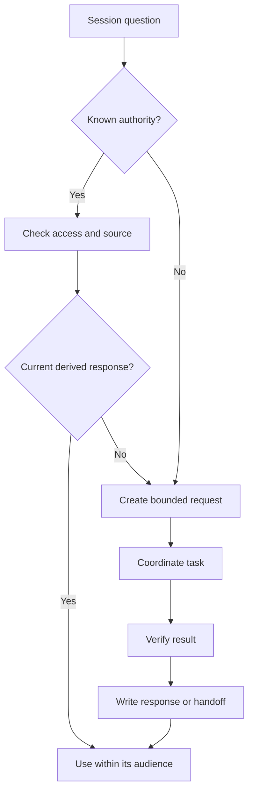
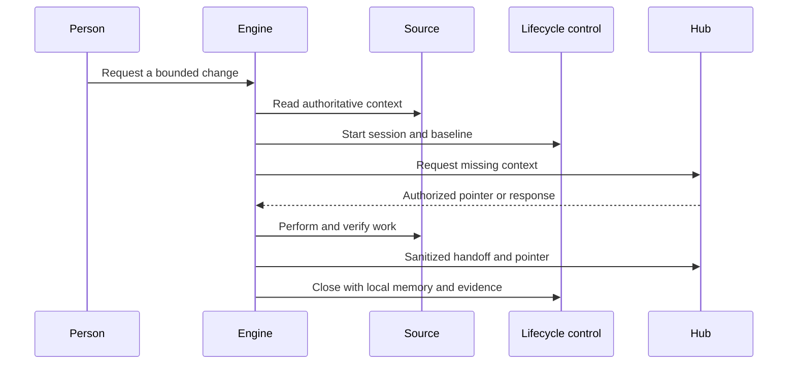

# Architecture and the mental model

**Language / Idioma:** English | [Espanol](../01-arquitectura.md)

Can I Play with Madness? Architecture provides the score: what each project
remembers and how different engines find the context they need.

## Layers and purpose

| Layer | Responsibility | Boundary |
|---|---|---|
| Working source | Code, documents and configuration for a domain | An old summary cannot override it |
| Local memory | Project decisions and continuity | Detailed memory remains in its project |
| Shared hub | Global memory, catalog, requests and handoffs | Private bodies are not collected indiscriminately |
| Orchestrator | Engine choice, task scope and next step | Producer and responsibility remain visible |
| Durable knowledge | Reusable principles and decisions | Operational evidence keeps its authority |
| Public surface | Explain judgment and patterns | Do not identify or reproduce the actual environment |

## Authority and routing

There is an authoritative source for each topic. Memory points to it or derives
from it with a classification, date and evidence. The source wins when a summary
contradicts current facts.

## Workflow objects

- RQ: a bounded information request to an authorized source.
- CA: a derived, sanitized and verifiable response.
- HO: a continuity handoff with state and next step.
- MEM: a durable decision or lesson in its authoritative destination.
- Receipt: session identity, artifacts and closure evidence.

Each object identifies the request or change, producer, source, audience,
supporting evidence and remaining work. These are contracts, not mandatory names.

## Why queries replace indiscriminate synchronization

Copying every source produces stale duplicates and ambiguous authority. The
source stays in its repository; the hub holds a minimal pointer. An engine
queries when context is missing, refreshes a stale response and explicitly
promotes a genuinely reusable decision.

## A session

## Design choices

Persist decisions, necessary context, evidence and next steps rather than entire
conversations. Separate detection from writing so a trigger can report a change
without permission to rewrite memory. Separate orchestration from execution so
delegation does not require handing out every credential or document. Keep
unknown, pending and authorization-required states visible.

Architecture alone does not solve identity, retention, document quality or model
errors. It provides a clear place to apply those controls and record results.

**Next:** [Project memory](07-project-memory.md) | [Reading path](README.md#reading-path)
