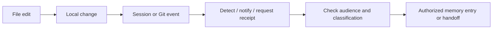

# Triggers, receipts and automation

**Language / Idioma:** English | [Espanol](../02-triggers-y-automatizacion.md)

Can I Play with Madness? Triggers bring a control in at the right time: session
start, closure or commit. A hook connects an event to a script; a local wrapper
adapts the event to a verification runtime. Memory records meaning, while a
receipt records identity and evidence.

## Events and boundaries

| Event | Safe reaction | Not automatic |
|---|---|---|
| Session start | Show pointers, baseline and divergence | Injecting private bodies or replacing governance reading |
| Pre-compaction | Preserve continuity | Deciding which secrets to summarize |
| Session close | Check identity, evidence and next step | Claiming success without verification |
| Pre-commit | Check hygiene, classification and applicable receipt | Generating narrative memory |
| Source post-commit | Signal material worth reviewing | Copying or publishing it |
| Explicit plan | Propose bounded operations with hashes and locks | Writing before authorized application |
| Explicit apply | Perform accepted operations | Changing unrelated surfaces |
| Verify | Compare artifacts and state | Silently rewriting contradictory facts |

## Editing versus persistence

A save creates a local change. A lifecycle event may detect divergence, request
a receipt or propose an update. Durable writing occurs only through the closure
contract or another authorized operation. The documented workflow has no
universal watcher that turns every editor save into narrative memory.



## A receipt

```text
project: logical project identifier
session_id: session identifier
engine: producing engine
root: verified root, kept private where required
memory_entry: decision or continuity reference
evidence: verified local files and state
coordination: pending | completed
```

A receipt is evidence of closure, not the narrative memory or proof that every
domain conclusion is correct.

## Start and close pseudocode

```text
on_start(project):
    verify_root(project)
    preserve_session_baseline()
    show(index_pointers, scoped_divergences)
    require_reading_of_authoritative_rules()

on_close(project, session):
    verify_local_files_and_status()
    if changed: require_local_memory_and_evidence()
    if coordination_completed: require_matching_hub_reference()
    save_receipt_with_identity_and_hashes()
```

If the hub is unavailable, local work can continue with coordination pending.
Read-only closure without changes produces no narrative, handoff or commit.

## Git controls and transactions

Pre-commit checks hygiene and private staged surfaces. With an AI session ID it
requires the corresponding current receipt; without one it does not attribute
closure to an identified session. A post-commit portfolio notice requests review;
sanitized writing and owner-controlled publication remain separate steps.

Larger operations follow Check, Plan, Review, Apply, Verify and Receipt. The plan
identifies scope and before/after hashes. Locks reduce concurrent write risk;
rollback stops if subsequent incompatible work has changed the target.

Portable tooling resolves a verified root instead of hardcoding paths in every
script. Location portability never overrides classification or access rules.

**Next:** [Routing](03-routing-and-triangulation.md) | [Reading path](README.md#reading-path)
