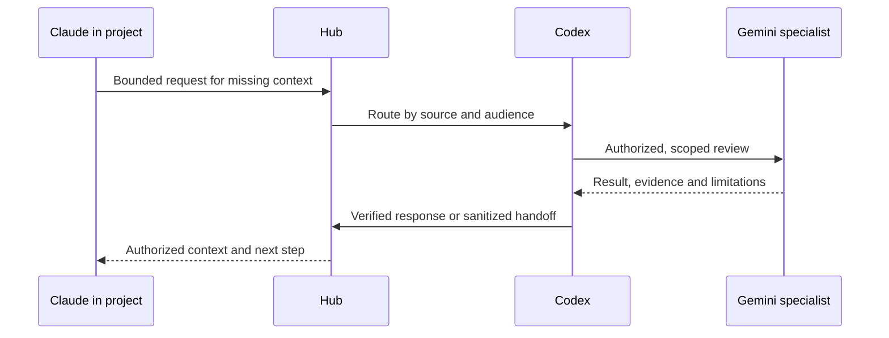

# Memory, routing and triangulation

**Language / Idioma:** English | [Espanol](../03-memoria-ruteo-y-triangulacion.md)

Can I Play with Madness? The router distributes the score according to who
needs it. It locates authority, checks audience and establishes freshness.

## Terms and purpose

| Term | Meaning | Purpose |
|---|---|---|
| Hub | Shared global memory, catalog and coordination | Find work without the previous chat |
| Router | Source lookup and access control | Prevent wrong-source or wrong-audience delivery |
| Audience | Authorized recipients | Keep internal responses within their intended group |
| Classification | Content handling rule | Decide whether a body, summary or pointer may travel |
| Freshness | Correspondence to the current source | Reject stale context |
| Cache | Reusable derived answer | Avoid repeated queries while evidence remains valid |
| Handoff | State and next step | Continue with another person or engine |
| Authority | Source that defines a topic's truth | Resolve conflicts with historical summaries |

Audience complements classification: internal does not mean accessible to every
team. A hash detects changes; it does not prove semantic correctness.

## An illustrative three-engine task



Claude finds code but lacks a historical reason. It requests context rather than
guessing. Codex locates the authorized source and can delegate a bounded review
through an available channel. Gemini returns conclusions and uncertainty. Codex
verifies the result; a handoff lets Claude continue.

The roles are interchangeable. A local model could take a suitable task. Shared
files transport context; automatic dispatch additionally requires a connector,
permissions and observed output. A design is not proof of an active integration.

## Freshness evidence

Record source identity, scoped subpath, its commit or version, uncommitted state,
measurement time, classification and audience. A global repository commit can
change for unrelated work, so freshness is scoped to the relevant source.
Uncommitted changes matter even when the last commit still matches. Ignored
memory can require file fingerprints; non-Git sources may use modification time.

## Classification

| Class | Handling |
|---|---|
| Public | May appear in a sanitized public example |
| Internal | Authorized organizational audience only |
| Local-only | Keep the body at its source; controlled pointer only |
| Indexed without content | Existence and routing metadata only |

An index permission never implies permission to read the indexed body.

## Handoff contract

```yaml
id: HO-example-topic
status: open
engine: producing-engine
source: logical-source-id
classification: internal
summary: minimum sanitized state
verified: facts checked at the source
next_step: concrete action
blocked_by: explicit blocker or none
audience: authorized-team
```

Where content cannot leave its domain, only a permitted pointer and local-query
requirement are recorded. The summary is never an unauthorized private body.

## Durable knowledge and Obsidian

Obsidian can provide reading, links and durable personal knowledge. Project memory
stays in the project, and global memory stays in the hub. A reusable lesson may
be selectively recorded in another authoritative destination under its audience
rules. There is no automatic pipeline copying every repository into a vault.

## Preventing loops

Objects have a producer, recipient and originating event. Outputs are not
automatically treated as new inputs. Session receipts prevent confusing one
closure with another, and durable promotion requires a meaningful decision.

**Next:** [Engines and budget](08-engines-fallback-and-tokens.md) | [Reading path](README.md#reading-path)
