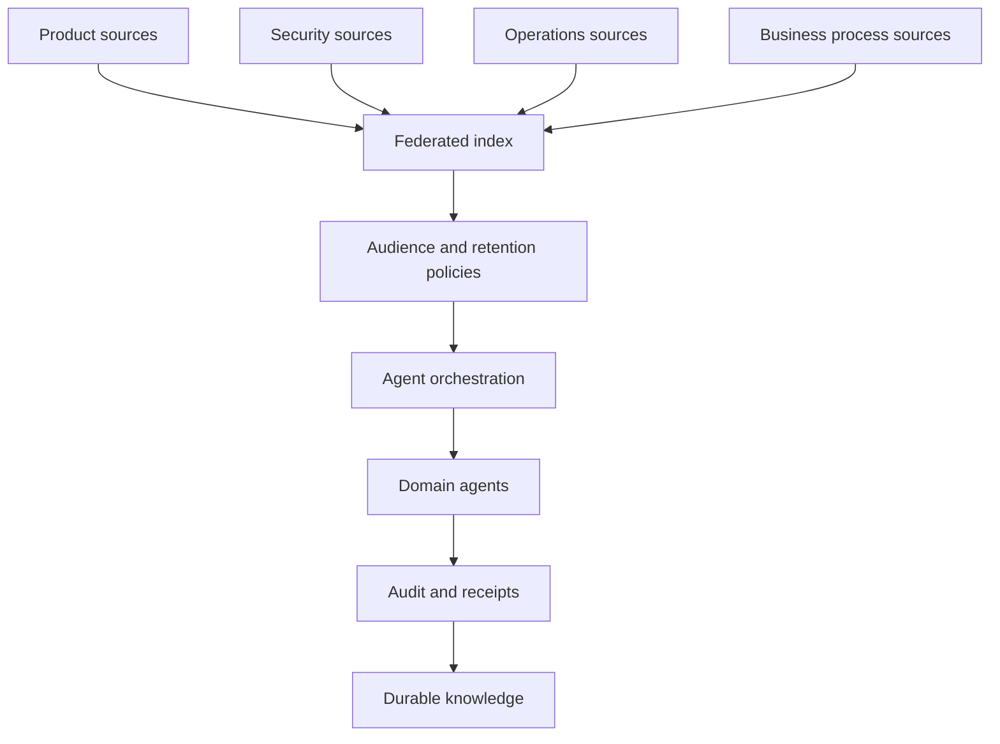

# Professional and enterprise scale

**Language / Idioma:** English | [Espanol](../04-escala-profesional.md)

Can I Play with Madness? At company scale, many contributors need domain owners,
access rules and current sources. Documents without those contracts multiply
the ambiguity agents receive.

## Reference topology

## Problems addressed

Structured handoffs preserve context between teams. Triggers signal documentation
that needs review after a source change. Durable decisions reduce dependency on
one person's private chat. A federated index helps agents consult the same
authority, while classification and minimal context constrain exposure.

| Domain | Example input | Controlled output |
|---|---|---|
| Engineering | Code change or architecture decision | Runbook update and technical handoff |
| Support | Resolved incident | Versioned diagnostic article |
| Security | Approved exception | Control, owner and expiration |
| Operations | Procedure change | Checklist and rollback |
| Legal and compliance | Current policy | Authorized pointer |
| People and processes | Internal workflow | Audience-restricted summary |

These outputs do not imply unrestricted sharing between domains.

## Adoption stages

1. Document discipline: name authoritative sources, define local memory and
   handoffs, agree on classifications and measure freshness manually.
2. Local controls: start/close verification, pre-commit hygiene, post-commit
   notices and receipts without sensitive bodies.
3. Router and federated index: resolve registered sources, deny unauthorized
   classifications, require versions and route to domain owners.
4. Multiagent orchestration: separate planning, execution and review; limit tools,
   budgets and duration; record handoffs and failures.
5. Enterprise knowledge: promote reusable decisions, define retention and deletion,
   measure coverage and add semantic search only where policy allows.

## Useful indicators

Measure current-source answer coverage, derived-answer age, time from source
change to documentation notice, open and blocked handoffs, source-free answers,
wrong-audience responses and rejected writes. Also measure how long it takes a
new contributor to recover minimum context.

Do not use generated word count as a proxy for useful memory. Indicators should
show whether the workflow helps and respects its boundaries.

## Risks and controls

| Risk | Control |
|---|---|
| Central index becomes a copy of everything | Federation and pointers |
| Agent receives excessive permissions | Tools and sources scoped by audience |
| Stale documents become current truth | Scoped versions, hashes and uncommitted state |
| Update loops | Idempotence, producer and originating event |
| Automation hides failures | Explicit states, receipts and evidence |
| Accidental publication | Separate allowlisted publication pipeline and human review |
| Provider dependency | Portable object contracts |

Sensitive legal, financial, medical, employment or critical security decisions
need a responsible approver and domain evidence. Agents can detect issues and
prepare a proposal; they do not silently approve it.

The expected benefit is operational memory that survives team, model and shift
changes, while authority remains with each domain.

**Next:** [Security](05-security-and-sanitization.md) | [Reading path](README.md#reading-path)
