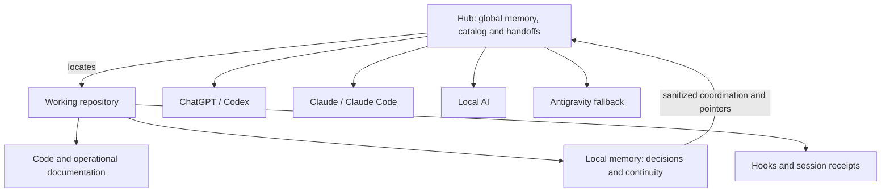

# Can I Play with Madness?

**Language / Idioma:** English | [Espanol](../../README.md)

> Yes. AI can improvise. Important decisions deserve a shared score.

<strong>SEVERAL MODELS | SHARED MEMORY | LASTING JUDGMENT</strong>

ChatGPT, Codex, Claude, Claude Code, local models and a fallback can contribute
to the same work. Each brings something useful; none magically remembers what
the others did. Without a protocol, the next session asks about a decision you
have already explained three times. Explaining it a fourth time starts to feel
like part of the job description.

This project demonstrates professional judgment in AI use: preserving decisions,
recovering context, checking results and managing capacity. We can play with
madness when multiple engines operate with memory, boundaries and a concrete
handoff process.

## In 30 seconds

| Problem | Design decision | Intended outcome |
|---|---|---|
| Each session starts with incomplete context | Project memory and a shared index | Less time reconstructing previous work |
| Another engine must continue a task | Structured, sanitized handoffs | Continuity across engines |
| Documentation falls behind code | Change detection, receipts and review | Visible changes with controlled updates |
| Private context could reach a public audience | Classification, audience and routing | Least privilege for information |
| Automation might claim work it never performed | Evidence and explicit states | Plans, facts and pending work remain distinct |

## The problem

AI engines do not reliably share memory across sessions, providers or work
surfaces. Questions repeat, decisions disappear into chats, documentation ages,
and oversized handoffs spread information unnecessarily.

The design treats memory as an information system: authoritative sources,
contracts, routing, freshness, permissions, traceability and rollback. AI assists
with reading, classification and execution within an explicitly defined scope.

## The architecture

The source holds operational truth. Local memory explains project decisions.
The hub carries global rules, a catalog and coordination. Orchestration assigns
bounded tasks, and durable knowledge preserves reusable principles.

Continue with [Architecture and the mental model](01-architecture.md).

## Global memory and project memory

Global memory holds cross-project rules and decisions. Every working repository
also keeps its own current state, decision history, verified evidence and next
steps. Detailed project memory is written once, inside that project. The hub
stores a pointer and the coordination needed to find it.

For example, code contains a validation that prevents duplicate submissions.
Project memory explains why it exists, how it was tested and what remains open.
The next engine reads that state before proposing a change.

Persistent memory means recovering external context when needed. It does not
change model weights. Documents preserve knowledge when the conversation ends;
platform memory remains secondary.

Read [The score inside each project](07-project-memory.md) for a complete session.

## Router, audience and freshness

The router locates an authoritative source and checks whether information may
be delivered. **Audience** identifies authorized recipients. A development team
and a public reader have different permissions. **Freshness** asks whether a
derived response still reflects its source. Yesterday's summary can already be
stale if the file changed today, even before a commit.

An authorized, current response can be reused. Otherwise the source is queried.
If access is denied, the workflow returns a pointer or stops the request.
"Send everything, just in case" works surprisingly well until somebody asks
what was in "everything".

Read [Routing and triangulation](03-routing-and-triangulation.md).

## What happens after a file changes?

Saving a file creates a local change. Lifecycle controls detect relevant events;
they do not write a new history entry for every keystroke.

1. Start reads governance, state and relevant handoffs, and can record a baseline.
2. Work changes the source and checks the result.
3. Close records local memory and evidence when changes occurred.
4. A receipt verifies the session identity and supporting artifacts.
5. A sanitized handoff sends coordination and a pointer to the hub.
6. Git checks hygiene and requires a current receipt when an AI session is identified.

Detection and durable writing are distinct actions. An explicit plan can propose
updates; an authorized application executes them. There is no universal watcher
in the documented workflow.

Read [Triggers, receipts and automation](02-triggers-and-automation.md).

## Engines and handoffs

| Tool or family | Role in this ecosystem |
|---|---|
| ChatGPT and Codex | Conversation and repository work; Codex verifies artifacts and can coordinate bounded tasks |
| Claude and Claude Code | Analysis and technical work; Claude Code has session lifecycle controls |
| Local Qwen3 Instruct and Qwen3 VL Instruct | Installed text and multimodal families; suitability is checked per task |
| Antigravity | Continuity fallback with minimal authorized context and conscious capacity use |

An illustrative triangulation has Claude working in a repository, Codex
consulting the right source and coordinating a bounded task, and Gemini reviewing
a limited part. Results return as evidence and a sanitized handoff. A document
transports context; automatic task dispatch also requires an available connector
and authority to use it.

Installed model files do not establish that a model is loaded or integrated.
No measured saving percentage or automatic usage-threshold switching is claimed.
Read [Engines, fallback and tokens](08-engines-fallback-and-tokens.md).

## Reading path

| Step | Question | Chapter |
|---|---|---|
| 01 | What problem started the design? | [Case study: lost context](case-studies/01-lost-context.md) |
| 02 | How do the parts fit together? | [Architecture](01-architecture.md) |
| 03 | What does each project remember? | [Project memory](07-project-memory.md) |
| 04 | Which event triggers which control? | [Triggers and receipts](02-triggers-and-automation.md) |
| 05 | Where does context go, and who may receive it? | [Routing and triangulation](03-routing-and-triangulation.md) |
| 06 | How are engines and capacity allocated? | [Engines and budget](08-engines-fallback-and-tokens.md) |
| 07 | How is information protected? | [Security and sanitization](05-security-and-sanitization.md) |
| 08 | How could a company adopt this? | [Professional scale](04-professional-scale.md) |
| 09 | Where should implementation start? | [Implementation playbook](06-implementation-playbook.md) |

## Professional value

The judgment lies in deciding what to remember, where, for whom and with what
evidence. Sources have owners, closures have checks, handoffs carry minimal
context, and projects remain usable when the hub is unavailable.

Within a company, product, support, operations and security can maintain their
own sources while contributing to a shared index. Agents find current context,
prepare updates and hand off work under domain permissions. Documentation
updates still require defined events and review. A huge knowledge base without
owners and access rules simply scales the confusion.

Read [Professional and enterprise scale](04-professional-scale.md).

## So, can we play with madness?

Yes. Local memory, one authority per topic and verifiable handoffs let us switch
engines without starting over. Four guitarists do not all need to play the solo.
The value comes from assigning the work and keeping the score.

## Publication and license

This is sanitized public documentation with abstract examples. It contains no
private operational configurations. Repository publication remains a separate
owner-controlled step. [MIT license](../../LICENSE.md).
